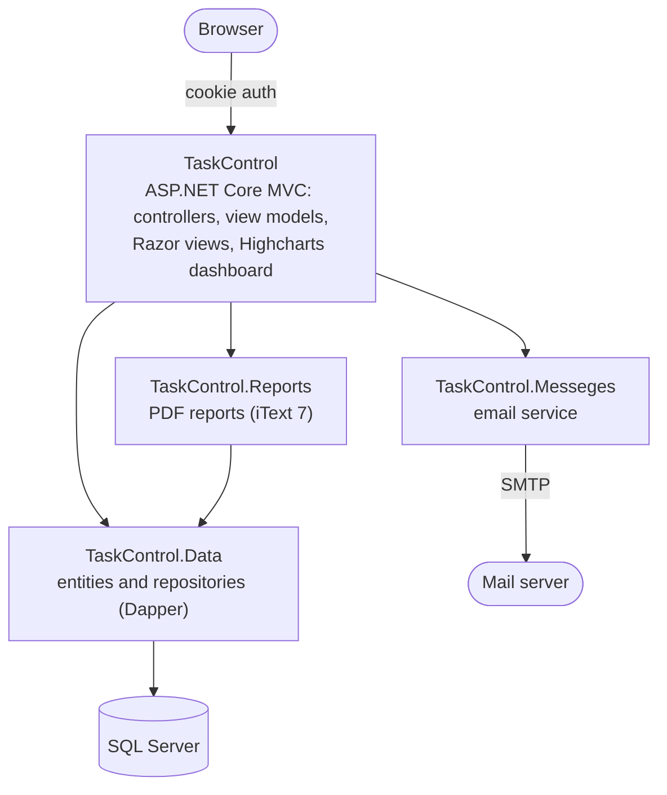
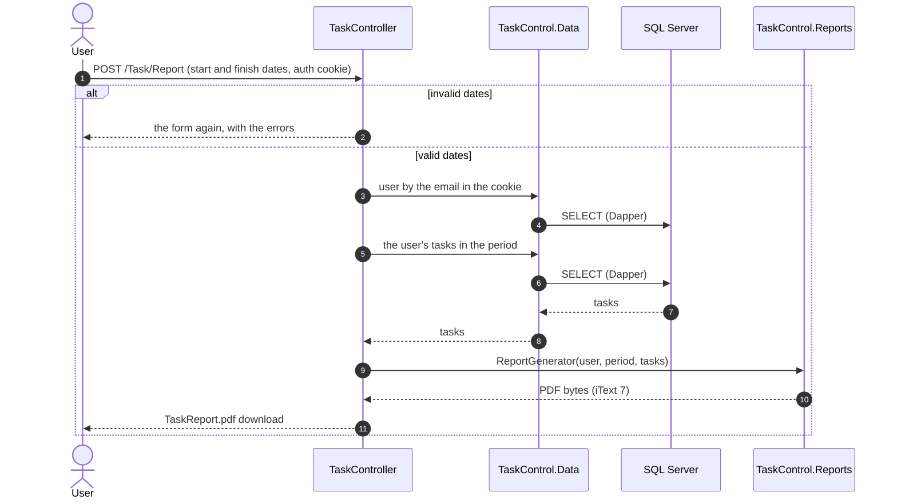

# TaskControl

[](https://github.com/joaogqueiroz/TaskControl/actions/workflows/ci.yml)

A full-stack task manager built with ASP.NET Core MVC. People create an account, register and edit their tasks with a date, time and priority, see their tasks in charts, and export reports to PDF.

## Features

- **Accounts:** registration, login with cookie authentication, password change and password recovery by email. Passwords are hashed with ASP.NET Core Identity's `PasswordHasher` (PBKDF2 with a per-user salt).
- **Password recovery:** the page gives the same answer whether or not the e-mail has an account. A registered e-mail gets a link with a random 256-bit token that works once and expires in 30 minutes; only its SHA-256 hash is stored, in `PASSWORD_RESET_TB`. The person chooses the new password on the link's page, and asking for a new link cancels the previous one. The link is built from the `AppUrl` setting, never from the request's Host header.
- **Tasks:** create, list, edit and delete tasks with a name, description, date, time and priority.
- **Dashboard:** Highcharts charts of the user's tasks.
- **Reports:** PDF reports of tasks in a date range, generated with iText 7.

## Architecture



## Generating a report



## Tech stack

C# · .NET 8 · ASP.NET Core MVC · Razor · Dapper · SQL Server · iText 7 · Highcharts · Bootstrap 5 · jQuery

## Running locally

Requirements: .NET 8 SDK and SQL Server (LocalDB works).

1. Create the database and run `SQLQuerys.sql` to create the `USER_TB`, `TASK_TB` and `PASSWORD_RESET_TB` tables. On an existing database, run just the `PASSWORD_RESET_TB` block; it only creates the table when it is missing.
2. Set `ConnectionStrings:DB_context` in `TaskControl/appsettings.json` to your database.
3. To enable password recovery, fill in the SMTP settings in `TaskControl.Messeges/EmailServiceMessage.cs` and set `AppUrl` in `appsettings.json` to the address people open the app on (the reset links point there).
4. Run it:

```sh
dotnet run --project TaskControl
```

## Tests

- `TaskControl.UnitTests` checks the form validation: required fields, lengths that match the database columns, e-mail format, the strong-password rule, dates and hours in the format the date and time inputs post, and report periods that end before they start. It also covers password recovery: the reset token and its hash, the same message for registered and unknown e-mails (also when sending fails), a link built from `AppUrl` even with a forged Host header, no password change until the link is used, and invalid or used tokens changing nothing.
- `TaskControl.IntegrationTests` runs the Dapper repositories against a real SQL Server. [Testcontainers](https://dotnet.testcontainers.org/) starts SQL Server 2022 in Docker and creates the tables from `SQLQuerys.sql`, so the only requirement is a running Docker. They cover sign-up, login and password changes with the hashed passwords, creating, listing, filtering by period, updating and deleting tasks, and the error cases: duplicate e-mails, values longer than their columns, tasks for users that do not exist, unknown ids and reversed periods. Password reset tokens work once, stop working when they expire or when a new one is requested, and change the password at the end of the flow.

```sh
dotnet test                         # both projects
dotnet test TaskControl.UnitTests   # no Docker needed
```
